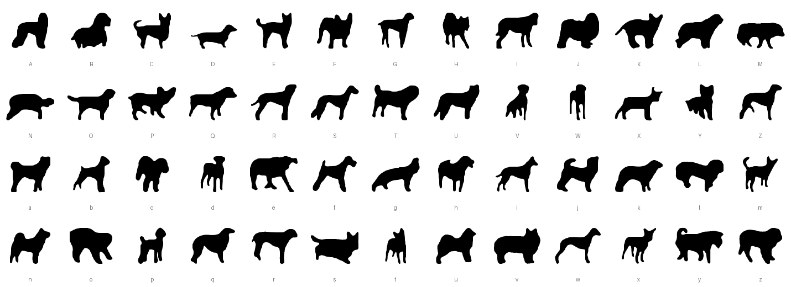

# LilPuppies

A font of dog silhouettes for unit charts, in the spirit of ProPublica's [WeePeople](https://github.com/propublica/weepeople). It covers the same characters as WeePeople: **A–Z and a–z** are 52 different dogs, and space is a dog-width gap. WeePeople has no digits, so LilPuppies has none either.

Each glyph is a different breed, traced from a photo in the [Dog CEO API](https://dog.ceo/dog-api/). Where a breed's name allows it, the letter is its initial (uppercase and lowercase are different breeds), so `B` is a basset hound and `b` a boxer. Dog CEO has no breeds starting with Q, U or Z, and only one each for O, V, X and Y, so some of those letters use other breeds.



Open `index.html` for a demo.

## Use

```html
<link rel="stylesheet" href="lilpuppies.css">
<span class="lilpuppies">BbDdGg</span>
```

`lilpuppies.css` embeds the font, so it is the only file you need. You can also load `lilpuppies.woff2`, `lilpuppies.woff` or `lilpuppies.ttf` with your own `@font-face`.

Every dog has the same advance width (1,000 units per em, like WeePeople's fixed-width people), so rows of dogs line up in a grid. Dogs stand on the baseline and are scaled to fit a 900 × 680 box, so a chihuahua is drawn as large as a Great Dane. Color them with CSS `color`.

## Key

<!-- KEY -->
| Letter | Breed | Source photo |
|---|---|---|
| `A` | Afghan Hound | [n02088094_7146.jpg](https://images.dog.ceo/breeds/hound-afghan/n02088094_7146.jpg) |
| `B` | Basset Hound | [n02088238_6708.jpg](https://images.dog.ceo/breeds/hound-basset/n02088238_6708.jpg) |
| `C` | Chihuahua | [black_chihuahua.jpg](https://images.dog.ceo/breeds/chihuahua/black_chihuahua.jpg) |
| `D` | Dachshund | [dachshund-1018409_640.jpg](https://images.dog.ceo/breeds/dachshund/dachshund-1018409_640.jpg) |
| `E` | American Eskimo Dog | [n02109961_4157.jpg](https://images.dog.ceo/breeds/eskimo/n02109961_4157.jpg) |
| `F` | French Bulldog | [n02108915_2807.jpg](https://images.dog.ceo/breeds/bulldog-french/n02108915_2807.jpg) |
| `G` | Great Dane | [n02109047_12569.jpg](https://images.dog.ceo/breeds/dane-great/n02109047_12569.jpg) |
| `H` | Siberian Husky | [n02110185_7210.jpg](https://images.dog.ceo/breeds/husky/n02110185_7210.jpg) |
| `I` | Irish Wolfhound | [n02090721_452.jpg](https://images.dog.ceo/breeds/wolfhound-irish/n02090721_452.jpg) |
| `J` | Japanese Chin | [n02085782_4574.jpg](https://images.dog.ceo/breeds/spaniel-japanese/n02085782_4574.jpg) |
| `K` | Kelpie | [n02105412_3075.jpg](https://images.dog.ceo/breeds/kelpie/n02105412_3075.jpg) |
| `L` | Leonberger | [n02111129_2617.jpg](https://images.dog.ceo/breeds/leonberg/n02111129_2617.jpg) |
| `M` | Alaskan Malamute | [n02110063_12656.jpg](https://images.dog.ceo/breeds/malamute/n02110063_12656.jpg) |
| `N` | Newfoundland | [n02111277_399.jpg](https://images.dog.ceo/breeds/newfoundland/n02111277_399.jpg) |
| `O` | Otterhound | [n02091635_2482.jpg](https://images.dog.ceo/breeds/otterhound/n02091635_2482.jpg) |
| `P` | Papillon | [n02086910_9579.jpg](https://images.dog.ceo/breeds/papillon/n02086910_9579.jpg) |
| `Q` | Beagle | [n02088364_10206.jpg](https://images.dog.ceo/breeds/beagle/n02088364_10206.jpg) |
| `R` | Rhodesian Ridgeback | [n02087394_2319.jpg](https://images.dog.ceo/breeds/ridgeback-rhodesian/n02087394_2319.jpg) |
| `S` | Saluki | [n02091831_3108.jpg](https://images.dog.ceo/breeds/saluki/n02091831_3108.jpg) |
| `T` | Tibetan Mastiff | [n02108551_2111.jpg](https://images.dog.ceo/breeds/mastiff-tibetan/n02108551_2111.jpg) |
| `U` | Border Collie | [n02106166_615.jpg](https://images.dog.ceo/breeds/collie-border/n02106166_615.jpg) |
| `V` | Vizsla | [n02100583_12308.jpg](https://images.dog.ceo/breeds/vizsla/n02100583_12308.jpg) |
| `W` | Weimaraner | [n02092339_748.jpg](https://images.dog.ceo/breeds/weimaraner/n02092339_748.jpg) |
| `X` | Xoloitzcuintli | [n02113978_451.jpg](https://images.dog.ceo/breeds/mexicanhairless/n02113978_451.jpg) |
| `Y` | Yorkshire Terrier | [n02094433_3766.jpg](https://images.dog.ceo/breeds/terrier-yorkshire/n02094433_3766.jpg) |
| `Z` | Scottish Deerhound | [n02092002_2981.jpg](https://images.dog.ceo/breeds/deerhound-scottish/n02092002_2981.jpg) |
| `a` | Akita | [japaneseakita.jpg](https://images.dog.ceo/breeds/akita/japaneseakita.jpg) |
| `b` | Boxer | [n02108089_5977.jpg](https://images.dog.ceo/breeds/boxer/n02108089_5977.jpg) |
| `c` | Cocker Spaniel | [n02102318_12053.jpg](https://images.dog.ceo/breeds/spaniel-cocker/n02102318_12053.jpg) |
| `d` | Doberman Pinscher | [n02107142_8399.jpg](https://images.dog.ceo/breeds/doberman/n02107142_8399.jpg) |
| `e` | English Springer Spaniel | [n02102040_5145.jpg](https://images.dog.ceo/breeds/springer-english/n02102040_5145.jpg) |
| `f` | Fox Terrier | [n02095314_2205.jpg](https://images.dog.ceo/breeds/terrier-fox/n02095314_2205.jpg) |
| `g` | German Shepherd | [n02106662_21348.jpg](https://images.dog.ceo/breeds/german-shepherd/n02106662_21348.jpg) |
| `h` | Bloodhound | [n02088466_8950.jpg](https://images.dog.ceo/breeds/hound-blood/n02088466_8950.jpg) |
| `i` | Ibizan Hound | [n02091244_596.jpg](https://images.dog.ceo/breeds/hound-ibizan/n02091244_596.jpg) |
| `j` | Russell Terrier | [jack-koda-1.jpg](https://images.dog.ceo/breeds/terrier-russell/jack-koda-1.jpg) |
| `k` | Kuvasz | [n02104029_4800.jpg](https://images.dog.ceo/breeds/kuvasz/n02104029_4800.jpg) |
| `l` | Lhasa Apso | [n02098413_7571.jpg](https://images.dog.ceo/breeds/lhasa/n02098413_7571.jpg) |
| `m` | Miniature Pinscher | [n02107312_5599.jpg](https://images.dog.ceo/breeds/pinscher-miniature/n02107312_5599.jpg) |
| `n` | Norwegian Elkhound | [n02091467_4906.jpg](https://images.dog.ceo/breeds/elkhound-norwegian/n02091467_4906.jpg) |
| `o` | Old English Sheepdog | [n02105641_12297.jpg](https://images.dog.ceo/breeds/sheepdog-english/n02105641_12297.jpg) |
| `p` | Standard Poodle | [n02113799_7438.jpg](https://images.dog.ceo/breeds/poodle-standard/n02113799_7438.jpg) |
| `q` | Borzoi | [n02090622_8236.jpg](https://images.dog.ceo/breeds/borzoi/n02090622_8236.jpg) |
| `r` | Redbone Coonhound | [n02090379_3372.jpg](https://images.dog.ceo/breeds/redbone/n02090379_3372.jpg) |
| `s` | Scottish Terrier | [n02097298_825.jpg](https://images.dog.ceo/breeds/terrier-scottish/n02097298_825.jpg) |
| `t` | Toy Terrier | [n02087046_1577.jpg](https://images.dog.ceo/breeds/terrier-toy/n02087046_1577.jpg) |
| `u` | Samoyed | [n02111889_1374.jpg](https://images.dog.ceo/breeds/samoyed/n02111889_1374.jpg) |
| `v` | Pembroke Welsh Corgi | [n02113023_4269.jpg](https://images.dog.ceo/breeds/pembroke/n02113023_4269.jpg) |
| `w` | Whippet | [n02091134_732.jpg](https://images.dog.ceo/breeds/whippet/n02091134_732.jpg) |
| `x` | Basenji | [n02110806_402.jpg](https://images.dog.ceo/breeds/basenji/n02110806_402.jpg) |
| `y` | Airedale Terrier | [n02096051_3538.jpg](https://images.dog.ceo/breeds/airedale/n02096051_3538.jpg) |
| `z` | St. Bernard | [n02109525_10297.jpg](https://images.dog.ceo/breeds/stbernard/n02109525_10297.jpg) |
<!-- /KEY -->

`lilpuppies.json` has the same key in machine-readable form.

## License and credits

- **Source photos:** Stanford Dogs Dataset (Khosla A. et al. 2011, *Novel dataset for fine-grained image categorization*, from ImageNet), served by the Dog CEO API. The dataset is licensed for **non-commercial research and education**. The silhouettes are traced from these photos, so **LilPuppies is for non-commercial use**.
- **Inspiration:** ProPublica's [WeePeople](https://github.com/propublica/weepeople) (CC BY-NC-ND 3.0 US). LilPuppies is not affiliated with ProPublica and uses none of WeePeople's shapes. It follows only the idea, the character set and the vertical metrics (1,000 units per em, ascender 800, descender −200).

## Rebuild

The build needs Python 3.12 with `torch`, `torchvision` (CPU is fine), `fonttools`, `brotli`, `opencv-python-headless`, `potracer`, `pillow` and `numpy`. Run from this folder:

1. `python -I build/fetch.py 30` downloads 30 photos per candidate breed into `.cache/images/` (git-ignored). The candidate breeds are in `build/breeds.py`.
2. `python -I build/segment.py` cuts each dog out with torchvision's Mask R-CNN (COCO weights). It keeps photos with exactly one dog, whole in the frame and not overlapped by a person. It scores each dog for a side-on, standing pose, judged by whether the legs show as separate shapes.
3. `python -I build/contact.py` draws contact sheets of the best candidates per breed in `.cache/sheets/`, for choosing by eye.
4. Edit `build/glyphs.json`. For each character it gives the breed, the photo's file name, and whether to mirror the dog (`flip`) so all dogs face the same way.
5. `python -I build/build_font.py` traces the masks with potrace and writes the fonts, `lilpuppies.css`, `lilpuppies.json` and `lilpuppies_all.png`.
6. `python -I build/demo.py` writes `index.html` and the key table above.
