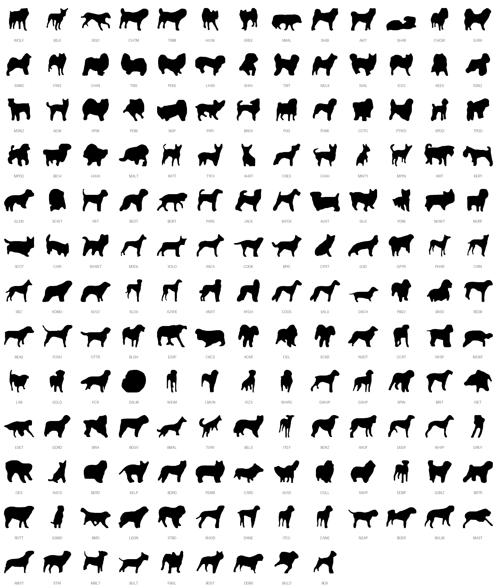

# LilPuppies

A font of dog silhouettes for unit charts, in the spirit of ProPublica's [WeePeople](https://github.com/propublica/weepeople). It covers the same characters as WeePeople: **A–Z and a–z** are 52 different dogs, and space is a dog-width gap. WeePeople has no digits, so LilPuppies has none either.

Each glyph is a different breed, traced from a photo in the [Dog CEO API](https://dog.ceo/dog-api/). Where a breed's name allows it, the letter is its initial (uppercase and lowercase are different breeds), so `B` is a basset hound and `b` a boxer. Dog CEO has no breeds starting with Q, U or Z, and only one each for O, V, X and Y, so some of those letters use other breeds.


The font also has **every breed in `breeds.json`**, the breed list of the genetics study. Each breed has a short code (`HUSK`, `BSJI`, `AKIT`, …) that draws its dog when discretionary ligatures are on, and its own character in Unicode's Private Use Area (from U+E000, in `breeds.json` order). A breed that also has a letter draws the same dog. Breeds that Dog CEO has no photos of are traced from Wikimedia Commons photos, credited in the table below.



Open `index.html` for a demo.

## Use

```html
<link rel="stylesheet" href="lilpuppies.css">
<span class="lilpuppies">BbDdGg</span>
<span class="lilpuppies-codes">HUSK BSJI AKIT</span>
```

`lilpuppies.css` embeds the font, so it is the only file you need. You can also load `lilpuppies.woff2`, `lilpuppies.woff` or `lilpuppies.ttf` with your own `@font-face`.

The `lilpuppies-codes` class sets `font-variant-ligatures: discretionary-ligatures`, which turns breed codes into dogs. It is a separate class so that ordinary capitals in the `lilpuppies` class (which may happen to spell a code, like `BOX` or `PUG`) stay letter dogs. In code, you can also use a breed's character directly; `lilpuppies_breeds.json` lists each code's character, name, clade and source photo.

Every dog has the same advance width (1,000 units per em, like WeePeople's fixed-width people), so rows of dogs line up in a grid. Dogs stand on the baseline and are scaled to fit a 900 × 680 box, so a chihuahua is drawn as large as a Great Dane. Color them with CSS `color`.

## Key

<!-- KEY -->
| Letter | Breed | Source photo |
|---|---|---|
| `A` | Afghan Hound | [n02088094_7146.jpg](https://images.dog.ceo/breeds/hound-afghan/n02088094_7146.jpg) |
| `B` | Basset Hound | [n02088238_6708.jpg](https://images.dog.ceo/breeds/hound-basset/n02088238_6708.jpg) |
| `C` | Chihuahua | [black_chihuahua.jpg](https://images.dog.ceo/breeds/chihuahua/black_chihuahua.jpg) |
| `D` | Dachshund | [dachshund-1018409_640.jpg](https://images.dog.ceo/breeds/dachshund/dachshund-1018409_640.jpg) |
| `E` | American Eskimo Dog | [n02109961_4157.jpg](https://images.dog.ceo/breeds/eskimo/n02109961_4157.jpg) |
| `F` | French Bulldog | [n02108915_2807.jpg](https://images.dog.ceo/breeds/bulldog-french/n02108915_2807.jpg) |
| `G` | Great Dane | [n02109047_12569.jpg](https://images.dog.ceo/breeds/dane-great/n02109047_12569.jpg) |
| `H` | Siberian Husky | [n02110185_7210.jpg](https://images.dog.ceo/breeds/husky/n02110185_7210.jpg) |
| `I` | Irish Wolfhound | [n02090721_452.jpg](https://images.dog.ceo/breeds/wolfhound-irish/n02090721_452.jpg) |
| `J` | Japanese Chin | [n02085782_4574.jpg](https://images.dog.ceo/breeds/spaniel-japanese/n02085782_4574.jpg) |
| `K` | Kelpie | [n02105412_3075.jpg](https://images.dog.ceo/breeds/kelpie/n02105412_3075.jpg) |
| `L` | Leonberger | [n02111129_2617.jpg](https://images.dog.ceo/breeds/leonberg/n02111129_2617.jpg) |
| `M` | Alaskan Malamute | [n02110063_12656.jpg](https://images.dog.ceo/breeds/malamute/n02110063_12656.jpg) |
| `N` | Newfoundland | [n02111277_399.jpg](https://images.dog.ceo/breeds/newfoundland/n02111277_399.jpg) |
| `O` | Otterhound | [n02091635_2482.jpg](https://images.dog.ceo/breeds/otterhound/n02091635_2482.jpg) |
| `P` | Papillon | [n02086910_9579.jpg](https://images.dog.ceo/breeds/papillon/n02086910_9579.jpg) |
| `Q` | Beagle | [n02088364_10206.jpg](https://images.dog.ceo/breeds/beagle/n02088364_10206.jpg) |
| `R` | Rhodesian Ridgeback | [n02087394_2319.jpg](https://images.dog.ceo/breeds/ridgeback-rhodesian/n02087394_2319.jpg) |
| `S` | Saluki | [n02091831_3108.jpg](https://images.dog.ceo/breeds/saluki/n02091831_3108.jpg) |
| `T` | Tibetan Mastiff | [n02108551_2111.jpg](https://images.dog.ceo/breeds/mastiff-tibetan/n02108551_2111.jpg) |
| `U` | Border Collie | [n02106166_615.jpg](https://images.dog.ceo/breeds/collie-border/n02106166_615.jpg) |
| `V` | Vizsla | [n02100583_12308.jpg](https://images.dog.ceo/breeds/vizsla/n02100583_12308.jpg) |
| `W` | Weimaraner | [n02092339_748.jpg](https://images.dog.ceo/breeds/weimaraner/n02092339_748.jpg) |
| `X` | Xoloitzcuintli | [n02113978_451.jpg](https://images.dog.ceo/breeds/mexicanhairless/n02113978_451.jpg) |
| `Y` | Yorkshire Terrier | [n02094433_3766.jpg](https://images.dog.ceo/breeds/terrier-yorkshire/n02094433_3766.jpg) |
| `Z` | Scottish Deerhound | [n02092002_2981.jpg](https://images.dog.ceo/breeds/deerhound-scottish/n02092002_2981.jpg) |
| `a` | Akita | [japaneseakita.jpg](https://images.dog.ceo/breeds/akita/japaneseakita.jpg) |
| `b` | Boxer | [n02108089_5977.jpg](https://images.dog.ceo/breeds/boxer/n02108089_5977.jpg) |
| `c` | Cocker Spaniel | [n02102318_12053.jpg](https://images.dog.ceo/breeds/spaniel-cocker/n02102318_12053.jpg) |
| `d` | Doberman Pinscher | [n02107142_8399.jpg](https://images.dog.ceo/breeds/doberman/n02107142_8399.jpg) |
| `e` | English Springer Spaniel | [n02102040_5145.jpg](https://images.dog.ceo/breeds/springer-english/n02102040_5145.jpg) |
| `f` | Fox Terrier | [n02095314_2205.jpg](https://images.dog.ceo/breeds/terrier-fox/n02095314_2205.jpg) |
| `g` | German Shepherd | [n02106662_21348.jpg](https://images.dog.ceo/breeds/german-shepherd/n02106662_21348.jpg) |
| `h` | Bloodhound | [n02088466_8950.jpg](https://images.dog.ceo/breeds/hound-blood/n02088466_8950.jpg) |
| `i` | Ibizan Hound | [n02091244_596.jpg](https://images.dog.ceo/breeds/hound-ibizan/n02091244_596.jpg) |
| `j` | Russell Terrier | [jack-koda-1.jpg](https://images.dog.ceo/breeds/terrier-russell/jack-koda-1.jpg) |
| `k` | Kuvasz | [n02104029_4800.jpg](https://images.dog.ceo/breeds/kuvasz/n02104029_4800.jpg) |
| `l` | Lhasa Apso | [n02098413_7571.jpg](https://images.dog.ceo/breeds/lhasa/n02098413_7571.jpg) |
| `m` | Miniature Pinscher | [n02107312_5599.jpg](https://images.dog.ceo/breeds/pinscher-miniature/n02107312_5599.jpg) |
| `n` | Norwegian Elkhound | [n02091467_4906.jpg](https://images.dog.ceo/breeds/elkhound-norwegian/n02091467_4906.jpg) |
| `o` | Old English Sheepdog | [n02105641_12297.jpg](https://images.dog.ceo/breeds/sheepdog-english/n02105641_12297.jpg) |
| `p` | Standard Poodle | [n02113799_7438.jpg](https://images.dog.ceo/breeds/poodle-standard/n02113799_7438.jpg) |
| `q` | Borzoi | [n02090622_8236.jpg](https://images.dog.ceo/breeds/borzoi/n02090622_8236.jpg) |
| `r` | Redbone Coonhound | [n02090379_3372.jpg](https://images.dog.ceo/breeds/redbone/n02090379_3372.jpg) |
| `s` | Scottish Terrier | [n02097298_825.jpg](https://images.dog.ceo/breeds/terrier-scottish/n02097298_825.jpg) |
| `t` | Toy Terrier | [n02087046_1577.jpg](https://images.dog.ceo/breeds/terrier-toy/n02087046_1577.jpg) |
| `u` | Samoyed | [n02111889_1374.jpg](https://images.dog.ceo/breeds/samoyed/n02111889_1374.jpg) |
| `v` | Pembroke Welsh Corgi | [n02113023_4269.jpg](https://images.dog.ceo/breeds/pembroke/n02113023_4269.jpg) |
| `w` | Whippet | [n02091134_732.jpg](https://images.dog.ceo/breeds/whippet/n02091134_732.jpg) |
| `x` | Basenji | [n02110806_402.jpg](https://images.dog.ceo/breeds/basenji/n02110806_402.jpg) |
| `y` | Airedale Terrier | [n02096051_3538.jpg](https://images.dog.ceo/breeds/airedale/n02096051_3538.jpg) |
| `z` | St. Bernard | [n02109525_10297.jpg](https://images.dog.ceo/breeds/stbernard/n02109525_10297.jpg) |
<!-- /KEY -->

`lilpuppies.json` has the same key in machine-readable form.

## Breeds

Mastino Abruzzese (`MAAB`) and Levriero Meridionale (`LVMD`) have no photo in `breed-images.json`, so they have no dog yet. The "COO" populations of Tibetan Mastiff, Saluki and Cane Corso share the dog of their US twin.

<!-- BREEDS -->
| Code | Character | Breed | Clade | Source photo |
|---|---|---|---|---|
| `WOLF` | U+E000 | Grey Wolf | Wild | [Wikimedia Commons](https://commons.wikimedia.org/wiki/File:Eurasian_wolf_2.jpg), User:Mas3cf, [CC BY-SA 4.0](https://creativecommons.org/licenses/by-sa/4.0) |
| `BSJI` | U+E001 | Basenji | Basenji | same dog as letter `x` |
| `XIGO` | U+E002 | Xigou | Asian Spitz | [Wikimedia Commons](https://commons.wikimedia.org/wiki/File:%E4%B8%80%E9%9A%BB%E9%81%A0%E8%99%95%E7%9A%84%E9%BB%91%E8%89%B2%E9%99%9D%E8%A5%BF%E7%B4%B0%E7%8A%AC.jpg), Wtf35861887, [CC0](http://creativecommons.org/publicdomain/zero/1.0/deed.en) |
| `CHTM` | U+E003 | Tibetan Mastiff - COO | Asian Spitz | same dog as `TIBM` |
| `TIBM` | U+E004 | Tibetan Mastiff - USA | Asian Spitz | same dog as letter `T` |
| `HUSK` | U+E005 | Siberian Husky | Asian Spitz | same dog as letter `H` |
| `GREE` | U+E006 | Greenland Sledge Dog | Asian Spitz | [Wikimedia Commons](https://commons.wikimedia.org/wiki/File:Greenland_dog_upernavik_2007-06-02_sample.jpg), Slaunger, edited by Thegreenj, [CC BY-SA 3.0](https://creativecommons.org/licenses/by-sa/3.0) |
| `AMAL` | U+E007 | Alaskan Malamute | Asian Spitz | same dog as letter `M` |
| `SHIB` | U+E008 | Shiba Inu | Asian Spitz | [shiba-1.jpg](https://images.dog.ceo/breeds/shiba/shiba-1.jpg) |
| `AKIT` | U+E009 | Akita | Asian Spitz | same dog as letter `a` |
| `SHAR` | U+E00A | Chinese Shar-Pei | Asian Spitz | [noel.jpg](https://images.dog.ceo/breeds/sharpei/noel.jpg) |
| `CHOW` | U+E00B | Chow Chow | Asian Spitz | [modi2.jpg](https://images.dog.ceo/breeds/chow/modi2.jpg) |
| `EURA` | U+E00C | Eurasier |  | [Wikimedia Commons](https://commons.wikimedia.org/wiki/File:Eurasier_BailyWtatze.jpg), Kerstin Kühnel Wuppertatzen, [CC0](http://creativecommons.org/publicdomain/zero/1.0/deed.en) |
| `SAMO` | U+E00D | Samoyed |  | same dog as letter `u` |
| `FINS` | U+E00E | Finish Spitz |  | [Wikimedia Commons](https://commons.wikimedia.org/wiki/File:Finnish_Spitz_600.jpg), Unknown author, [CC BY-SA 3.0](http://creativecommons.org/licenses/by-sa/3.0/) |
| `CHIN` | U+E00F | Japanese Chin | Asian Toy | same dog as letter `J` |
| `TIBS` | U+E010 | Tibetan Spaniel | Asian Toy | [Wikimedia Commons](https://commons.wikimedia.org/wiki/File:Tibetansk_spaniel.jpg), Wolfman1, [CC BY-SA 3.0](http://creativecommons.org/licenses/by-sa/3.0/) |
| `PEKE` | U+E011 | Pekingese | Asian Toy | [n02086079_606.jpg](https://images.dog.ceo/breeds/pekinese/n02086079_606.jpg) |
| `LHSA` | U+E012 | Lhasa Apso | Asian Toy | same dog as letter `l` |
| `SHIH` | U+E013 | Shih Tzu | Asian Toy | [n02086240_1665.jpg](https://images.dog.ceo/breeds/shihtzu/n02086240_1665.jpg) |
| `TIBT` | U+E014 | Tibetan Terrier |  | [n02097474_2941.jpg](https://images.dog.ceo/breeds/terrier-tibetan/n02097474_2941.jpg) |
| `NELK` | U+E015 | Norwegian Elkhound | Nordic Spitz | same dog as letter `n` |
| `SVAL` | U+E016 | Swedish Vallhund | Nordic Spitz | [Wikimedia Commons](https://commons.wikimedia.org/wiki/File:V%C3%A4stg%C3%B6taspets_hane_5_%C3%A5r.jpg), TS Eriksson, [CC BY 3.0](https://creativecommons.org/licenses/by/3.0) |
| `ICES` | U+E017 | Icelandic Sheepdog | Nordic Spitz | [Wikimedia Commons](https://commons.wikimedia.org/wiki/File:Icelandic_Sheepdog_Alisa_von_Lehenberg.jpg), Veronica Druk, [CC BY-SA 3.0](https://creativecommons.org/licenses/by-sa/3.0) |
| `KEES` | U+E018 | Keeshond | Nordic Spitz | [n02112350_8572.jpg](https://images.dog.ceo/breeds/keeshond/n02112350_8572.jpg) |
| `SSNZ` | U+E019 | Standard Schnauzer | Schnauzer | [n02097209_479.jpg](https://images.dog.ceo/breeds/schnauzer/n02097209_479.jpg) |
| `MSNZ` | U+E01A | Miniature Schnauzer | Schnauzer | [n02097047_6203.jpg](https://images.dog.ceo/breeds/schnauzer-miniature/n02097047_6203.jpg) |
| `AESK` | U+E01B | American Eskimo Dog | Small Spitz | same dog as letter `E` |
| `VPIN` | U+E01C | Volpino | Small Spitz | [Wikimedia Commons](https://commons.wikimedia.org/wiki/File:Szpic_miniaturowy_Volpino_MWPR_Katowice_2008_(cropped).JPG), Lilly M real name: Małgorzata Miłaszewska, [CC BY-SA 3.0](https://creativecommons.org/licenses/by-sa/3.0) |
| `POM` | U+E01D | Pomeranian | Small Spitz | [n02112018_9753.jpg](https://images.dog.ceo/breeds/pomeranian/n02112018_9753.jpg) |
| `SKIP` | U+E01E | Schipperke | Toy Spitz | [n02104365_5411.jpg](https://images.dog.ceo/breeds/schipperke/n02104365_5411.jpg) |
| `PAPI` | U+E01F | Papillon | Toy Spitz | same dog as letter `P` |
| `BRUS` | U+E020 | Brussels Griffon | Toy Spitz | [n02112706_292.jpg](https://images.dog.ceo/breeds/brabancon/n02112706_292.jpg) |
| `PUG` | U+E021 | PugDog | Toy Spitz | [n02110958_15129.jpg](https://images.dog.ceo/breeds/pug/n02110958_15129.jpg) |
| `PUMI` | U+E023 | Pumi | Hungarian | [Wikimedia Commons](https://commons.wikimedia.org/wiki/File:Pumi_2.jpg), Caronna, [CC BY-SA 3.0](http://creativecommons.org/licenses/by-sa/3.0/) |
| `COTO` | U+E024 | Coton de Tulear | Poodle | [img_20160830_202631573.jpg](https://images.dog.ceo/breeds/cotondetulear/img_20160830_202631573.jpg) |
| `PTWD` | U+E025 | Portuguese Water Dog | Poodle | [Wikimedia Commons](https://commons.wikimedia.org/wiki/File:C%C3%A3o_de_agua_Portugu%C3%AAs_2.jpg), Silke Hollje-Schumacher, [CC BY-SA 3.0](http://creativecommons.org/licenses/by-sa/3.0/) |
| `SPOO` | U+E026 | Standard Poodle | Poodle | same dog as letter `p` |
| `TPOO` | U+E027 | Toy Poodle | Poodle | [n02113624_2308.jpg](https://images.dog.ceo/breeds/poodle-toy/n02113624_2308.jpg) |
| `MPOO` | U+E028 | Miniature Poodle | Poodle | [n02113712_5289.jpg](https://images.dog.ceo/breeds/poodle-miniature/n02113712_5289.jpg) |
| `BICH` | U+E029 | Bichon Frise | Poodle | [jh-ezio-2.jpg](https://images.dog.ceo/breeds/frise-bichon/jh-ezio-2.jpg) |
| `HAVA` | U+E02A | Havanese | Poodle | [00100trportrait_00100_burst20191112123933390_cover.jpg](https://images.dog.ceo/breeds/havanese/00100trportrait_00100_burst20191112123933390_cover.jpg) |
| `MALT` | U+E02B | Maltese | Poodle | [n02085936_1244.jpg](https://images.dog.ceo/breeds/maltese/n02085936_1244.jpg) |
| `RATT` | U+E02C | Rat Terrier | American Terrier | [Wikimedia Commons](https://commons.wikimedia.org/wiki/File:Amberina_the_Rat_Terrier.jpg), Jadenschaul, [CC BY-SA 4.0](https://creativecommons.org/licenses/by-sa/4.0) |
| `TYFX` | U+E02D | Toy Fox Terrier | American Terrier | [Wikimedia Commons](https://commons.wikimedia.org/wiki/File:Toy_Fox_Terrier_2.jpg), Terry Best, [CC BY-SA 3.0](https://creativecommons.org/licenses/by-sa/3.0) |
| `AHRT` | U+E02E | American Hairless Terrier | American Terrier | [Wikimedia Commons](https://commons.wikimedia.org/wiki/File:American_Hairless_Terrier_Adelor.jpg), Nyaah, [CC BY-SA 3.0](https://creativecommons.org/licenses/by-sa/3.0) |
| `CRES` | U+E02F | Chinese Crested | American Toy | [Wikimedia Commons](https://commons.wikimedia.org/wiki/File:IndyStands.jpg), Tommy Gildseth, [CC BY 3.0](https://creativecommons.org/licenses/by/3.0) |
| `CHIH` | U+E030 | Chihuahua | American Toy | same dog as letter `C` |
| `MNTY` | U+E031 | Toy Manchester Terrier | Pinscher | [Wikimedia Commons](https://commons.wikimedia.org/wiki/File:ToyManchesterTerrier.jpg), sally9258, [CC BY 2.0](https://creativecommons.org/licenses/by/2.0) |
| `MPIN` | U+E032 | Miniature Pinscher | Pinscher | same dog as letter `m` |
| `AIRT` | U+E033 | Airedale Terrier | Terrier | same dog as letter `y` |
| `KERY` | U+E034 | Kerry Blue Terrier | Terrier | [n02093859_1003.jpg](https://images.dog.ceo/breeds/terrier-kerryblue/n02093859_1003.jpg) |
| `GLEN` | U+E035 | Glen of Imaal Terrier | Terrier | [Wikimedia Commons](https://commons.wikimedia.org/wiki/File:Blue_Brindle_Adult_Glen_of_Imaal_Terrier.jpg), Irish-Terrier-2023, [CC BY-SA 4.0](https://creativecommons.org/licenses/by-sa/4.0) |
| `SCWT` | U+E036 | Soft Coated Wheaten Terrier | Terrier | [n02098105_3731.jpg](https://images.dog.ceo/breeds/terrier-wheaten/n02098105_3731.jpg) |
| `IRIT` | U+E037 | Irish Terrier | Terrier | [n02093991_1335.jpg](https://images.dog.ceo/breeds/terrier-irish/n02093991_1335.jpg) |
| `BEDT` | U+E038 | Bedlington Terrier | Terrier | [n02093647_1791.jpg](https://images.dog.ceo/breeds/terrier-bedlington/n02093647_1791.jpg) |
| `BORT` | U+E039 | Border Terrier | Terrier | [n02093754_1062.jpg](https://images.dog.ceo/breeds/terrier-border/n02093754_1062.jpg) |
| `PARS` | U+E03A | Parson Russell Terrier | Terrier | [Wikimedia Commons](https://commons.wikimedia.org/wiki/File:05052881_PRT_braun_rau.jpg), Alephalpha, [CC BY-SA 3.0](https://creativecommons.org/licenses/by-sa/3.0) |
| `JACK` | U+E03B | Jack Russell terrier | Terrier | same dog as letter `j` |
| `WFOX` | U+E03C | Wire Fox Terrier | Terrier | same dog as letter `f` |
| `AUST` | U+E03D | Australian Terrier | Terrier | [n02096294_2432.jpg](https://images.dog.ceo/breeds/terrier-australian/n02096294_2432.jpg) |
| `SILK` | U+E03E | Silky Terrier | Terrier | [n02097658_2329.jpg](https://images.dog.ceo/breeds/terrier-silky/n02097658_2329.jpg) |
| `YORK` | U+E03F | Yorkshire Terrier | Terrier | same dog as letter `Y` |
| `NOWT` | U+E040 | Norwich Terrier | Terrier | [n02094258_847.jpg](https://images.dog.ceo/breeds/terrier-norwich/n02094258_847.jpg) |
| `NORF` | U+E041 | Norfolk Terrier | Terrier | [n02094114_4501.jpg](https://images.dog.ceo/breeds/terrier-norfolk/n02094114_4501.jpg) |
| `SCOT` | U+E042 | Scottish Terrier | Terrier | same dog as letter `s` |
| `CAIR` | U+E043 | Cairn Terrier | Terrier | [n02096177_13114.jpg](https://images.dog.ceo/breeds/terrier-cairn/n02096177_13114.jpg) |
| `WHWT` | U+E044 | West Highland White Terrier | Terrier | [n02098286_275.jpg](https://images.dog.ceo/breeds/terrier-westhighland/n02098286_275.jpg) |
| `MXOL` | U+E045 | Miniature Xoloitzcuintli | New World | [Wikimedia Commons](https://commons.wikimedia.org/wiki/File:BIR_Grupp_5-_MEXIKANSK_NAKENHUND,_Lokal_Hero%E2%80%99s_King_Og_Hart%E2%80%99s_Istas_(23607403303).jpg), Svenska Mässan from Sweden, [CC BY 2.0](https://creativecommons.org/licenses/by/2.0) |
| `XOLO` | U+E046 | Xoloitzcuintli | New World | same dog as letter `X` |
| `INCA` | U+E047 | Peruvian Hairless Dog | New World | [Wikimedia Commons](https://commons.wikimedia.org/wiki/File:PHDStandardStanding_-_Perro_Sin_Pelo_del_Per%C3%BA.jpg), Brunobarreto, Public domain |
| `COOK` | U+E048 | Chinook | New World | [Wikimedia Commons](https://commons.wikimedia.org/wiki/File:Mountan_Laurel_Ajax_the_Chinook_dog.jpg), Unknown author, Copyrighted free use |
| `BPIC` | U+E049 | Berger Picard | New World | [Wikimedia Commons](https://commons.wikimedia.org/wiki/File:Picard_Delice_Stacked.jpg), Cufleadh, [CC BY-SA 3.0](https://creativecommons.org/licenses/by-sa/3.0) |
| `CPAT` | U+E04A | Cane Paratore | New World | [Wikimedia Commons](https://commons.wikimedia.org/wiki/File:Cane_Paratore.jpg), Chili The Border Collie, [CC BY-SA 4.0](https://creativecommons.org/licenses/by-sa/4.0) |
| `GSD` | U+E04B | German Shepherd Dog | New World | same dog as letter `g` |
| `GPYR` | U+E04C | Great Pyrenees | Mediterranean | [n02111500_9003.jpg](https://images.dog.ceo/breeds/pyrenees/n02111500_9003.jpg) |
| `PHAR` | U+E04D | Pharaoh Hound | Mediterranean | [Wikimedia Commons](https://commons.wikimedia.org/wiki/File:Pies_faraona_e34.jpg), Pleple2000, [CC BY-SA 3.0](http://creativecommons.org/licenses/by-sa/3.0/) |
| `CIRN` | U+E04E | Cirneco dell'Etna | Mediterranean | [Wikimedia Commons](https://commons.wikimedia.org/wiki/File:Cirneco_dell_Etna_611.jpg), de:Benutzer:Jan Eduard, contrast Pleple2000, [CC BY-SA 3.0](http://creativecommons.org/licenses/by-sa/3.0/) |
| `IBIZ` | U+E04F | Ibizan Hound | Mediterranean | same dog as letter `i` |
| `KOMO` | U+E050 | Komondor | Mediterranean | [n02105505_4271.jpg](https://images.dog.ceo/breeds/komondor/n02105505_4271.jpg) |
| `KUVZ` | U+E051 | Kuvasz | Mediterranean | same dog as letter `k` |
| `SLOU` | U+E053 | Sloughi | Mediterranean | [Wikimedia Commons](https://commons.wikimedia.org/wiki/File:Sloughi_male.jpg), Denhulde, [CC BY-SA 3.0](https://creativecommons.org/licenses/by-sa/3.0) |
| `AZWK` | U+E055 | Azawakh | Mediterranean | [Wikimedia Commons](https://commons.wikimedia.org/wiki/File:Bistrita_2015_(22).jpg), Cristian.vantu, [CC BY-SA 4.0](https://creativecommons.org/licenses/by-sa/4.0) |
| `ANAT` | U+E056 | Anatolian Shepherd | Mediterranean | [Wikimedia Commons](https://commons.wikimedia.org/wiki/File:Kangal_front_on.jpg), Kangalshepherddog, [CC BY-SA 4.0](https://creativecommons.org/licenses/by-sa/4.0) |
| `AFGH` | U+E057 | Afghan Hound | Mediterranean | same dog as letter `A` |
| `COOS` | U+E058 | Saluki - COO | Mediterranean | same dog as `SALU` |
| `SALU` | U+E059 | Saluki - USA | Mediterranean | same dog as letter `S` |
| `DACH` | U+E05A | Dachshund | Scent Hound | same dog as letter `D` |
| `PBGV` | U+E05B | Petit Basset Griffon Vendeen | Scent Hound | [Wikimedia Commons](https://commons.wikimedia.org/wiki/File:P_Basset_Griffon_Vendeen_600.jpg), Sannse, [CC BY-SA 3.0](http://creativecommons.org/licenses/by-sa/3.0/) |
| `BASS` | U+E05C | Basset Hound | Scent Hound | same dog as letter `B` |
| `REDB` | U+E05D | Redbone Coonhound | Scent Hound | same dog as letter `r` |
| `BEAG` | U+E05E | Beagle | Scent Hound | same dog as letter `Q` |
| `FOXH` | U+E05F | Foxhound | Scent Hound | [n02089973_3647.jpg](https://images.dog.ceo/breeds/hound-english/n02089973_3647.jpg) |
| `OTTR` | U+E060 | Otterhound | Scent Hound | same dog as letter `O` |
| `BLDH` | U+E061 | Bloodhound | Scent Hound | same dog as letter `h` |
| `ESSP` | U+E062 | English Springer Spaniel | Spaniel | same dog as letter `e` |
| `CKCS` | U+E063 | Cavalier King Charles Spaniel | Spaniel | [n02086646_1246.jpg](https://images.dog.ceo/breeds/spaniel-blenheim/n02086646_1246.jpg) |
| `ACKR` | U+E064 | American Cocker Spaniel | Spaniel | same dog as letter `c` |
| `FIEL` | U+E065 | Field Spaniel | Spaniel | [Wikimedia Commons](https://commons.wikimedia.org/wiki/File:Field_spaniel_581.jpg), Pleple2000, [CC BY-SA 3.0](http://creativecommons.org/licenses/by-sa/3.0/) |
| `ECKR` | U+E066 | English Cocker Spaniel | Spaniel | same dog as letter `c` |
| `NSDT` | U+E067 | Nova Scotia Duck Tolling Retriever | Retriever | [Wikimedia Commons](https://commons.wikimedia.org/wiki/File:Duck_Toller.jpg), Cal119 at English Wikipedia, Public domain |
| `CCRT` | U+E068 | Curly-coated Retriever | Retriever | [n02099429_1372.jpg](https://images.dog.ceo/breeds/retriever-curly/n02099429_1372.jpg) |
| `IWSP` | U+E069 | Irish Water Spaniel | Retriever | [n02102973_4566.jpg](https://images.dog.ceo/breeds/spaniel-irish/n02102973_4566.jpg) |
| `NEWF` | U+E06A | Newfoundland | Retriever | same dog as letter `N` |
| `LAB` | U+E06B | Labrador Retriever | Retriever | [n02099712_4845.jpg](https://images.dog.ceo/breeds/labrador/n02099712_4845.jpg) |
| `GOLD` | U+E06C | Golden Retriever | Retriever | [n02099601_7119.jpg](https://images.dog.ceo/breeds/retriever-golden/n02099601_7119.jpg) |
| `FCR` | U+E06D | Flat-coated Retriever | Retriever | [n02099267_5073.jpg](https://images.dog.ceo/breeds/retriever-flatcoated/n02099267_5073.jpg) |
| `DALM` | U+E06E | Dalmatian | Pointer Setter | [cooper1.jpg](https://images.dog.ceo/breeds/dalmatian/cooper1.jpg) |
| `WEIM` | U+E06F | Weimaraner | Pointer Setter | same dog as letter `W` |
| `LMUN` | U+E070 | Large Munsterlander | Pointer Setter | [Wikimedia Commons](https://commons.wikimedia.org/wiki/File:GrosserMuensterlaender.jpg), Pia C. Groening, [CC BY-SA 3.0](http://creativecommons.org/licenses/by-sa/3.0/) |
| `VIZS` | U+E071 | Vizsla | Pointer Setter | same dog as letter `V` |
| `WHPG` | U+E072 | Wirehaired Pointing Griffon | Pointer Setter | [Wikimedia Commons](https://commons.wikimedia.org/wiki/File:GCH_Int_Ch_UCH_Zerubbabel_von_Herrenhausen_CGC_MHA.jpg), CarolPtak, [CC BY-SA 4.0](https://creativecommons.org/licenses/by-sa/4.0) |
| `GWHP` | U+E073 | German Wirehaired Pointer | Pointer Setter | [Wikimedia Commons](https://commons.wikimedia.org/wiki/File:Dan_vom_hardenberg_(cropped).jpg), JainaKo, [CC BY-SA 3.0](https://creativecommons.org/licenses/by-sa/3.0) |
| `GSHP` | U+E074 | German Shorthaired Pointer | Pointer Setter | [n02100236_619.jpg](https://images.dog.ceo/breeds/pointer-german/n02100236_619.jpg) |
| `SPIN` | U+E075 | Spinone Italiano | Pointer Setter | [Wikimedia Commons](https://commons.wikimedia.org/wiki/File:05042363_Spinone_braun.jpg), Alephalpha, [CC BY-SA 3.0](https://creativecommons.org/licenses/by-sa/3.0) |
| `BRIT` | U+E076 | Brittany | Pointer Setter | [n02101388_990.jpg](https://images.dog.ceo/breeds/spaniel-brittany/n02101388_990.jpg) |
| `ISET` | U+E077 | Irish Setter | Pointer Setter | [n02100877_585.jpg](https://images.dog.ceo/breeds/setter-irish/n02100877_585.jpg) |
| `ESET` | U+E078 | English Setter | Pointer Setter | [n02100735_4949.jpg](https://images.dog.ceo/breeds/setter-english/n02100735_4949.jpg) |
| `GORD` | U+E079 | Gordon Setter | Pointer Setter | [n02101006_751.jpg](https://images.dog.ceo/breeds/setter-gordon/n02101006_751.jpg) |
| `BRIA` | U+E07A | Briard | Continental Herder | [n02105251_7950.jpg](https://images.dog.ceo/breeds/briard/n02105251_7950.jpg) |
| `BOUV` | U+E07B | Bouvier des Flandres | Continental Herder | [n02106382_3571.jpg](https://images.dog.ceo/breeds/bouvier/n02106382_3571.jpg) |
| `BMAL` | U+E07C | Belgian Malinois | Continental Herder | [n02105162_7593.jpg](https://images.dog.ceo/breeds/malinois/n02105162_7593.jpg) |
| `TURV` | U+E07D | Belgian Tervuren | Continental Herder | [shadow_and_lake.jpg](https://images.dog.ceo/breeds/tervuren/shadow_and_lake.jpg) |
| `BELS` | U+E07E | Belgian Sheepdog | Continental Herder | [n02105056_3741.jpg](https://images.dog.ceo/breeds/groenendael/n02105056_3741.jpg) |
| `ITGY` | U+E07F | Italian Greyhound | UKRural | [n02091032_11088.jpg](https://images.dog.ceo/breeds/greyhound-italian/n02091032_11088.jpg) |
| `BORZ` | U+E080 | Borzoi | UKRural | same dog as letter `q` |
| `IWOF` | U+E081 | Irish Wolfhound | UKRural | same dog as letter `I` |
| `DEER` | U+E082 | Scottish Deerhound | UKRural | same dog as letter `Z` |
| `WHIP` | U+E083 | Whippet | UKRural | same dog as letter `w` |
| `GREY` | U+E084 | Greyhound | UKRural | [cordelia.jpg](https://images.dog.ceo/breeds/greyhound/cordelia.jpg) |
| `OES` | U+E085 | Old English Sheepdog | UKRural | same dog as letter `o` |
| `AUCD` | U+E086 | Australian Cattle Dog | UKRural | [img_3668.jpg](https://images.dog.ceo/breeds/cattledog-australian/img_3668.jpg) |
| `BERD` | U+E087 | Bearded Collie | UKRural | [Wikimedia Commons](https://commons.wikimedia.org/wiki/File:Bearded_Collie_600.jpg), Unknown author, [CC BY-SA 3.0](http://creativecommons.org/licenses/by-sa/3.0/) |
| `KELP` | U+E088 | Kelpie | UKRural | same dog as letter `K` |
| `BORD` | U+E089 | Border Collie | UKRural | same dog as letter `U` |
| `PEMB` | U+E08A | Pembroke Welsh Corgi | UKRural | same dog as letter `v` |
| `CARD` | U+E08B | Cardigan Welsh Corgi | UKRural | [n02113186_9579.jpg](https://images.dog.ceo/breeds/corgi-cardigan/n02113186_9579.jpg) |
| `AUSS` | U+E08C | Australian Shepherd | UKRural | [leroy.jpg](https://images.dog.ceo/breeds/australian-shepherd/leroy.jpg) |
| `COLL` | U+E08D | Collie | UKRural | [1dog-rough-collie-portrait.jpg](https://images.dog.ceo/breeds/rough-collie/1dog-rough-collie-portrait.jpg) |
| `SSHP` | U+E08E | Shetland Sheepdog | UKRural | [n02105855_12087.jpg](https://images.dog.ceo/breeds/sheepdog-shetland/n02105855_12087.jpg) |
| `DOBP` | U+E08F | Doberman Pinscher | Drover | same dog as letter `d` |
| `GSNZ` | U+E090 | Giant Schnauzer | Drover | [n02097130_3628.jpg](https://images.dog.ceo/breeds/schnauzer-giant/n02097130_3628.jpg) |
| `BRTR` | U+E091 | Black Russian Terrier | Drover | [Wikimedia Commons](https://commons.wikimedia.org/wiki/File:Wystawa_Rybnik_02.10.2011_czarny_terier_rosyjski_2pl.jpg), Pleple2000, [CC BY-SA 3.0](https://creativecommons.org/licenses/by-sa/3.0) |
| `ROTT` | U+E092 | Rottweiler | Drover | [n02106550_9432.jpg](https://images.dog.ceo/breeds/rottweiler/n02106550_9432.jpg) |
| `GSMD` | U+E093 | Greater Swiss Mountain Dog | Alpine | [n02107574_2650.jpg](https://images.dog.ceo/breeds/mountain-swiss/n02107574_2650.jpg) |
| `BMD` | U+E094 | Bernese Mountain Dog | Alpine | [n02107683_1244.jpg](https://images.dog.ceo/breeds/mountain-bernese/n02107683_1244.jpg) |
| `LEON` | U+E095 | Leonberger | Alpine | same dog as letter `L` |
| `STBD` | U+E096 | Saint Bernard | Alpine | same dog as letter `z` |
| `RHOD` | U+E097 | Rhodesian Ridgeback | European Mastiff | same dog as letter `R` |
| `DANE` | U+E098 | Great Dane | European Mastiff | same dog as letter `G` |
| `ITCC` | U+E099 | Cane Corso - COO | European Mastiff | same dog as `CANE` |
| `CANE` | U+E09A | Cane Corso - USA | European Mastiff | [Wikimedia Commons](https://commons.wikimedia.org/wiki/File:Cane_corso_temi_1_1024x768x24_(cropped).png), Claudio Domiziani, [CC BY-SA 2.5](https://creativecommons.org/licenses/by-sa/2.5) |
| `NEAP` | U+E09B | Neapolitan Mastiff | European Mastiff | [Wikimedia Commons](https://commons.wikimedia.org/wiki/File:5_Year_old_male_in_Napoli_Stance_(2).jpg), Philip Thompson, [CC BY-SA 3.0](https://creativecommons.org/licenses/by-sa/3.0) |
| `BOER` | U+E09C | Boerboel | European Mastiff | [Wikimedia Commons](https://commons.wikimedia.org/wiki/File:Boerboelmusta3.jpg), Canarian, [CC BY 4.0](https://creativecommons.org/licenses/by/4.0) |
| `BULM` | U+E09D | Bullmastiff | European Mastiff | [n02108422_1975.jpg](https://images.dog.ceo/breeds/mastiff-bull/n02108422_1975.jpg) |
| `MAST` | U+E09E | English Mastiff | European Mastiff | [3.jpg](https://images.dog.ceo/breeds/mastiff-english/3.jpg) |
| `AMST` | U+E09F | American Staffordshire Terrier | European Mastiff | [n02093428_19652.jpg](https://images.dog.ceo/breeds/terrier-american/n02093428_19652.jpg) |
| `STAF` | U+E0A0 | Staffordshire Bull Terrier | European Mastiff | [n02093256_1275.jpg](https://images.dog.ceo/breeds/bullterrier-staffordshire/n02093256_1275.jpg) |
| `MBLT` | U+E0A1 | Miniature Bull Terrier | European Mastiff | [Wikimedia Commons](https://commons.wikimedia.org/wiki/File:Minibull_2_Moletai_May_2014.jpg), Томасина, [CC BY-SA 4.0](https://creativecommons.org/licenses/by-sa/4.0) |
| `BULT` | U+E0A2 | Bull Terrier | European Mastiff | [Wikimedia Commons](https://commons.wikimedia.org/wiki/File:Bullterrier-3453301920.jpg), Pixabay User TC-TORRES, [CC0](http://creativecommons.org/publicdomain/zero/1.0/deed.en) |
| `FBUL` | U+E0A3 | French Bulldog | European Mastiff | same dog as letter `F` |
| `BOST` | U+E0A4 | Boston Terrier | European Mastiff | [n02096585_6855.jpg](https://images.dog.ceo/breeds/bulldog-boston/n02096585_6855.jpg) |
| `DDBX` | U+E0A5 | Dogue de Bordeaux | European Mastiff | [Wikimedia Commons](https://commons.wikimedia.org/wiki/File:French_Mastiff_female_4.jpg), Canarian, [CC BY-SA 4.0](https://creativecommons.org/licenses/by-sa/4.0) |
| `BULD` | U+E0A6 | Bulldog | European Mastiff | [jager-1.jpg](https://images.dog.ceo/breeds/bulldog-english/jager-1.jpg) |
| `BOX` | U+E0A7 | Boxer | European Mastiff | same dog as letter `b` |
<!-- /BREEDS -->

`lilpuppies_breeds.json` has the same table in machine-readable form, with each photo's page, author and license.

## License and credits

- **Source photos:** Stanford Dogs Dataset (Khosla A. et al. 2011, *Novel dataset for fine-grained image categorization*, from ImageNet), served by the Dog CEO API. The dataset is licensed for **non-commercial research and education**. The silhouettes are traced from these photos, so **LilPuppies is for non-commercial use**.
- **Wikimedia Commons photos:** breeds that Dog CEO lacks are traced from Wikimedia Commons photos. Each one's author and license (mostly Creative Commons BY or BY-SA) is in the breed table above and in `lilpuppies_breeds.json`.
- **Inspiration:** ProPublica's [WeePeople](https://github.com/propublica/weepeople) (CC BY-NC-ND 3.0 US). LilPuppies is not affiliated with ProPublica and uses none of WeePeople's shapes. It follows only the idea, the character set and the vertical metrics (1,000 units per em, ascender 800, descender −200).

## Rebuild

`segment.py` keeps the mask of a dog that fails a check (several dogs, cut off by the frame, a person in the way) as a fallback for breeds with only one or two photos.

The build needs Python 3.12 with `torch`, `torchvision` (CPU is fine), `fonttools`, `brotli`, `opencv-python-headless`, `potracer`, `pillow` and `numpy`. Run from this folder:

1. `python -I build/fetch.py 30` downloads 30 photos per candidate breed into `.cache/images/` (git-ignored). The candidate breeds are in `build/breeds.py`.
2. `python -I build/segment.py` cuts each dog out with torchvision's Mask R-CNN (COCO weights). It keeps photos with exactly one dog, whole in the frame and not overlapped by a person. It scores each dog for a side-on, standing pose, judged by whether the legs show as separate shapes.
3. `python -I build/contact.py` draws contact sheets of the best candidates per breed in `.cache/sheets/`, for choosing by eye.
4. Edit `build/glyphs.json`. For each character it gives the breed, the photo's file name, and whether to mirror the dog (`flip`) so all dogs face the same way.
5. For every breed in `breeds.json`: `python -I build/fetch.py --breeds` downloads candidates listed in `breed-images.json` (Dog CEO and Wikimedia Commons), then rerun step 2. `python -I build/pick.py` picks a photo per breed into `build/breed_glyphs.json`, reusing a letter's dog where the breed has one; it guesses which way each dog faces. To override a pick, edit its `file` or `flip` and set `"auto": false`. `build/catalog.py` reads the two JSON files.
6. `python -I build/build_font.py` traces the masks with potrace and writes the fonts, `lilpuppies.css`, `lilpuppies.json`, `lilpuppies_breeds.json`, `lilpuppies_all.png` and `lilpuppies_breeds.png`.
7. `python -I build/demo.py` writes `index.html` and the key tables above.
